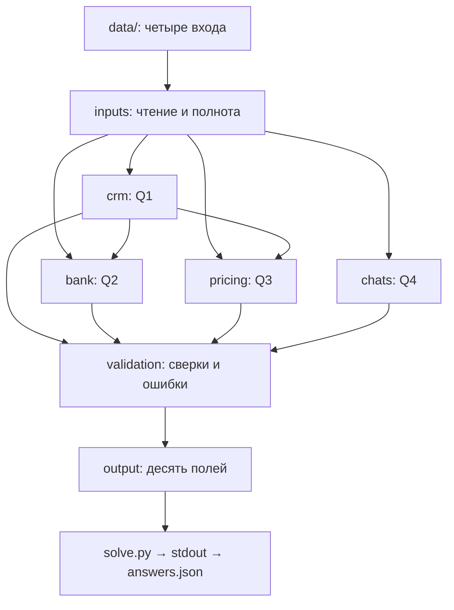

# Архитектура AK Furs

**Статус:** реализованы частные Q1 (`crm.py`), Q2 (`bank.py`), Q3 (`pricing.py`) и Q4 (`chats.py`) через `python -m akfurs.<module>` с предметными тестами. Q4 переносит проверенный G02 AI-адаптер в исходный код и использует существующий `codex exec`. Полный Python CLI Q1–Q4 остаётся планируемым. Проектный стек Data Skills — вспомогательная инфраструктура; его финансовый протокол не является реализацией Q2/Q3 или смысловым validator Q4.

## Существующая структура

```text
shelenkov-test-akfurs/
├── README.md
├── AGENTS.md
├── .gitignore
├── src/akfurs/
│   ├── AGENTS.md
│   ├── __init__.py
│   ├── crm.py
│   ├── bank.py
│   ├── pricing.py
│   ├── chats.py
│   └── q4_resources/               # prompt, JSON Schema, policy
├── contracts/AGENTS.md
├── tests/
│   ├── AGENTS.md
│   ├── test_crm.py
│   ├── test_bank.py
│   ├── test_pricing.py
│   ├── test_chats.py
│   └── fixtures/synthetic/AGENTS.md
├── docs/
│   ├── AGENTS.md
│   ├── ARCHITECTURE.md
│   ├── EMPLOYER_REVIEW_GUIDE.md
│   └── review.md
├── inbox/                         # локальный исходный комплект, вне Git
└── data/                          # пустой локальный каталог входов, вне Git
```

`inbox/` содержит четыре операционных файла, исходный шаблон и ТЗ, экспортированное в DOCX. Материалы не перемещаются и не редактируются. `data/` предназначен для отдельной копии четырёх входов при будущем разрешённом запуске. Пустой `data/` не сохраняется Git; перед запуском его нужно создать и заполнить по README.

## Планируемые файлы

Дополнительно к исходному дереву существуют `.agents/skills/akfurs-*`,
`tools/data_processing/` (один вспомогательный CLI с модулями CSV/XLSX,
quality/reconciliation/validation), `tests/data_skills/`, `docs/data_skills/`
и исключённая из Git `.venv`. Это локальный слой инструментов; он не создаёт
параллельного решения Q1–Q5, сервисов или хранилища. Его контракт canonical
records и schema reconciliation protocol не являются контрактом `answers.json`.
Подробности и воспроизведение — [USAGE](data_skills/USAGE.md).

Существующий `crm.py` читает только CRM: строгий CSV → нормализованные ключи → счётчики Q1 и отбор максимального `Выгружено` → раздельные статусы Q1/канонической CRM и приватные основания. Ошибка ключа/структуры удерживает Q1; конфликт payload на максимуме удерживает CRM для Q2/Q3. Прайс, скидки и банк не фильтруют счётчики. Модуль не создаёт полный `answers.json` и не подтверждает поля будущих Q2/Q3.

`bank.py` использует текущую CRM из `crm.py`, читает банковские операции, извлекает контекстные ссылки и считает Q2a/Q2b. Его частный CLI сохраняет отдельные статусы, полные основания и точный баланс; не создаёт финальный `answers.json`. Общие финансовые Skills с проверками достаточности оплаты не подменяют предметный Q2.

`pricing.py` получает ту же каноническую CRM и читает оригинальные листы через существующий `inspect_xlsx`, сохраняя точные XML-числа и локаторы. Он применяет явные aliases, историю на дату создания, скидку на строку и точное сравнение без округления. Статусы общего итога и разбивки по менеджерам раздельны; потеря строк запрещена. Частный CLI не пересчитывает Q2 и не собирает полный `answers.json`; его денежный JSON использует существующий serializer без изменения `bank.py`.

`chats.py` читает исходный ZIP, проверяет состав/ID/сообщения и последовательно передаёт полный чат в новый `codex exec`. Ресурсы — `q4_resources/prompt.txt`, `response.schema.json`, `POLICY.md`; cwd создаётся программно. Модель извлекает смысловые события; код проверяет JSONL/schema/роли/exact quotes, вычисляет Unicode spans и порядок, затем итог. Недействительный ответ, неразобранный файл или неопределённость исключают успешный частичный Q4. Журнал fresh вызовов, исходные основания и timing/usage сохраняются приватно. Локальные кэшированные ответы и resume не используются; возможный серверный prefix cache отражается в usage отдельно.

Exact quote validation не доказывает полноту событий: каждый положительный и отрицательный чат независимо проверяется по оригиналу. Read-only не является полной изоляцией чтения; инструкции в raw не исполняются. Первый полный baseline одной версии фиксируется до оптимизации. Следующий отдельный G05-PERF обязателен; его запуск и решение R2 требуют следующего поручения/решения владельца.

Эти пути описывают будущую реализацию и сейчас отсутствуют:

| Путь | Ответственность |
|---|---|
| `solve.py` | Тонкая точка входа, вызовы модулей, exit code |
| `src/akfurs/inputs.py` | Чтение четырёх файлов, форматы и полнота |
| `src/akfurs/validation.py` | Сверки, инварианты и блокирующие ошибки |
| `src/akfurs/output.py` | Сборка десяти полей JSON |
| `contracts/answers.schema.json` | Машинная проверка структуры ответа |
| `tests/test_{output,end_to_end}.py` | Остальные предметные и сквозные проверки |
| `requirements.txt` | Зависимости после выбора реализации |

Локальные результаты: `answers.json` в корне; Q5, основания, диагностика и AI-экспорты в `private/`; кэш в `.cache/`, если понадобится. Эти пути исключены из Git и создаются только по необходимости.

## Поток данных



Поток запланирован. Исходный ТЗ и шаблон задают правила и контракт; в четыре операционных входа они не входят. Q5 готовится отдельно после приёмки расчётов.

## Границы

Точная денежная арифметика и предметные правила закреплены в [инструкциях модулей](../src/akfurs/AGENTS.md), JSON — в [контракте](../contracts/AGENTS.md), проверки — в [tests](../tests/AGENTS.md). CLI выдаёт только полный JSON либо явную ошибку.

Способ AI-анализа Q4 проверен в G02, R0 принят. Сохраняется исправление G02-IR-01 для malformed runtime event/item. Предметный G05 расширяет охват до полного оригинального корпуса и готовит технический R2, не подменяя решение владельца. Новые runtime, зависимости и глобальные настройки не требуются; скрытый эталон и переносимость полного решения проверяются отдельно.

Реализация допускается отдельным поручением с соблюдением [этапов и R0–R3](review.md). Не добавляются сервисы и зависимости ради оформления. Готовность полного CLI, схемы всего ответа и окончательного комплекта пока не подтверждена.
