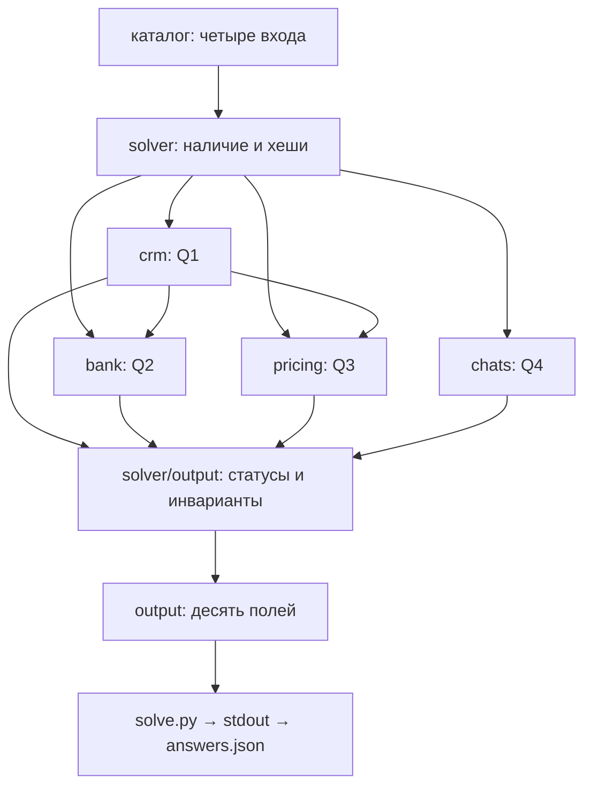

# Архитектура AK Furs

**Статус:** реализованы частные Q1 (`crm.py`), Q2 (`bank.py`), Q3 (`pricing.py`) и Q4 (`chats.py`), общий `solve.py` и схема ответа. Q4 использует существующий `codex exec`. Первый полный живой интеграционный запуск прошёл и признан владельцем достаточным для завершения G06 и продолжения. Сбой второго запуска сохранён как техническое ограничение. Проектный стек Data Skills — вспомогательная инфраструктура; его финансовый протокол не является реализацией Q2/Q3 или смысловым validator Q4.

## Существующая структура

```text
shelenkov-test-akfurs/
├── README.md
├── AGENTS.md
├── .gitignore
├── solve.py                        # тонкая точка входа
├── src/akfurs/
│   ├── AGENTS.md
│   ├── __init__.py
│   ├── crm.py
│   ├── bank.py
│   ├── pricing.py
│   ├── chats.py
│   ├── solver.py                   # четыре входа, Q1–Q4, evidence, exit
│   ├── output.py                   # полный контракт и инварианты
│   └── q4_resources/               # prompt, JSON Schema, policy
├── contracts/                     # AGENTS.md и answers.schema.json
├── tests/
│   ├── AGENTS.md
│   ├── test_crm.py
│   ├── test_bank.py
│   ├── test_pricing.py
│   ├── test_chats.py
│   ├── test_output.py
│   ├── test_end_to_end.py
│   └── fixtures/synthetic/AGENTS.md
├── docs/
│   ├── AGENTS.md
│   ├── ARCHITECTURE.md
│   ├── EMPLOYER_REVIEW_GUIDE.md
│   └── review.md
├── inbox/                         # локальный исходный комплект, вне Git
└── data/                          # пустой локальный каталог входов, вне Git
```

`inbox/` содержит четыре операционных файла, исходный шаблон и ТЗ, экспортированное в DOCX. Материалы не перемещаются и не редактируются. `data/` предназначен для отдельной копии четырёх входов при будущем разрешённом запуске. Пустой `data/` не сохраняется Git; перед запуском его нужно создать и заполнить по README.

## Модули и границы

Дополнительно к исходному дереву существуют `.agents/skills/akfurs-*`,
`tools/data_processing/` (один вспомогательный CLI с модулями CSV/XLSX,
quality/reconciliation/validation), `tests/data_skills/`, `docs/data_skills/`
и исключённая из Git `.venv`. Это локальный слой инструментов; он не создаёт
параллельного решения Q1–Q5, сервисов или хранилища. Его контракт canonical
records и schema reconciliation protocol не являются контрактом `answers.json`.
Подробности и воспроизведение — [USAGE](data_skills/USAGE.md).

Существующий `crm.py` читает только CRM: строгий CSV → нормализованные ключи → счётчики Q1 и отбор максимального `Выгружено` → раздельные статусы Q1/канонической CRM и приватные основания. Ошибка ключа/структуры удерживает Q1; конфликт payload на максимуме удерживает CRM для Q2/Q3. Прайс, скидки и банк не фильтруют счётчики. Модуль не создаёт полный `answers.json` и не подтверждает поля будущих Q2/Q3.

`bank.py` использует текущую CRM из `crm.py`, читает банковские операции, извлекает контекстные ссылки и считает Q2a/Q2b. Его частный CLI сохраняет отдельные статусы, полные основания и точный баланс; не создаёт финальный `answers.json`. Общие финансовые Skills с проверками достаточности оплаты не подменяют предметный Q2.

`pricing.py` получает ту же каноническую CRM и читает оригинальные листы через существующий `inspect_xlsx`, сохраняя точные XML-числа и локаторы. Он применяет явные aliases, историю на дату создания, скидку на строку и точное сравнение без округления. Статусы общего итога и разбивки по менеджерам раздельны; потеря строк запрещена. Частный CLI не пересчитывает Q2 и не собирает полный `answers.json`; его денежный JSON использует существующий serializer без изменения `bank.py`.

`chats.py` читает исходный ZIP, проверяет состав/ID/сообщения и передаёт полный чат в новый `codex exec`. Ресурсы — `q4_resources/prompt.txt`, `response.schema.json`, `POLICY.md`; cwd создаётся программно. Модель извлекает смысловые события; код проверяет JSONL/schema/роли/exact quotes, вычисляет Unicode spans и порядок, затем итог. Недействительный ответ, неразобранный файл или неопределённость исключают успешный частичный Q4. Журнал fresh вызовов, исходные основания и timing/usage сохраняются приватно. Локальные кэшированные ответы и resume не используются; возможный серверный prefix cache отражается в usage отдельно.

API `run_zip(..., workers=1)` и CLI `--workers` допускают от одного до четырёх одновременных заданий, по умолчанию одно. Координатор отправляет ограниченное число полных чатов в `ThreadPoolExecutor`; запросы, ответы и каталоги заданий раздельны. Только координатор обновляет общий реестр, счётчики, usage и timing; итоговый порядок соответствует исходному ZIP. После блокирующей runtime-ошибки он прекращает отправку и учитывает все уже отправленные задания. Неотправленные записи остаются `NOT_CHECKED`, итог — `HOLD`; предметная неопределённость отдельного чата допускает независимое продолжение остальных без выдачи успешного частичного ответа.

В `RUN.json` отдельно отражаются запрошенное и максимальное наблюдаемое число одновременных заданий, submitted/completed/not_started и известные вызовы subprocesses. При недоступных данных отдельного задания счётчик неизвестных заданий увеличивается, а общий `subprocess_calls` становится `null`; неизвестное число не подменяется нулём. В параллельном режиме сумма времён subprocesses может превышать wall time всего запуска. Для сравнения полных запусков используется внешнее время CLI; native timing и usage приводятся отдельно.

Exact quote validation не доказывает полноту событий: каждый положительный и отрицательный чат независимо проверяется по оригиналу. Read-only не является полной изоляцией чтения; инструкции в raw не исполняются. Первый полный baseline одной версии зафиксирован до оптимизации. G05-PERF начат с кандидатом на четыре одновременных задания при прежних модели, запросе, policy и schema. Локальные проверки координатора пройдены. Парная выборка дала 200,82 с при одном задании и 60,19 с при четырёх; это один замер с разным серверным prefix cache. Новый полный запуск остановлен по native reconnect/timeout: все 24 отправленных задания учтены, 126 не запускались. Полное ускорение и полная смысловая эквивалентность остаются `HOLD`; частичное время не сравнивается с завершённым baseline. Решение владельца по R2 учитывается отдельно.

`solver.py` проверяет наличие всех четырёх именованных входов, запускает существующие API Q1–Q3, сохраняет раздельные результаты и балансы в новом evidence. При HOLD зависимого расчёта до Q4 не доходит. Контроль хешей входов и источников частных вычислений предотвращает смешение изменившихся файлов. Затем выполняется новый `run_zip`, без готовых Q4-ответов. `output.py` собирает ровно десять полей, проверяет JSON Schema и взаимные ограничения. Повторное чтение CRM существующими API сохранено без изменения предметных модулей.

`solve.py` подключает локальные модули и вызывает `solver.main`. Полный JSON сериализуется через существующий Decimal-preserving `bank.dumps_json`; он выдаётся в stdout только после финализации evidence. В evidence сохраняется SHA-256 точного JSON, отдельная преждевременная копия полного ответа не создаётся. Ошибка означает exit 2 и пустой stdout. Схема находится в `contracts/answers.schema.json`, проверки — `tests/test_output.py` и `tests/test_end_to_end.py`.

Отдельные `inputs.py` и `validation.py` не понадобились: проверки остаются в координаторе и существующих предметных читателях. Новые runtime и зависимости не добавлялись; используется существующая `.venv` и зависимости `tools/data_processing/requirements.in`/`requirements.lock`. Переносимость среды работодателя ещё не проверена.

Локальные результаты: `answers.json` в корне; Q5, основания, диагностика и AI-экспорты в `private/`; кэш в `.cache/`, если понадобится. Эти пути исключены из Git и создаются только по необходимости.

## Поток данных



Поток реализован; первый полный модельный запуск через общий CLI подтверждён (150 чатов), второй остановлен после 99 заданий по событию reconnect/timeout. Все отправленные задания учтены, частичный JSON не выдан, третий запуск не начат. Итого 249 свежих subprocess-вызовов, 249 уникальных сессий, неизвестных вызовов и повторов адаптера нет. Серия из трёх успешных запусков не завершена; владелец снял этот внутренний критерий и разрешил продолжение по первому проверенному результату. Исходный ТЗ и шаблон задают правила и контракт; в четыре операционных входа они не входят. Q5 подготовлен отдельно по этому результату и прошёл независимый recheck; приёмка владельцем учитывается отдельно.

## Границы

Точная денежная арифметика и предметные правила закреплены в [инструкциях модулей](../src/akfurs/AGENTS.md), JSON — в [контракте](../contracts/AGENTS.md), проверки — в [tests](../tests/AGENTS.md). CLI выдаёт только полный JSON либо явную ошибку.

Способ AI-анализа Q4 проверен в G02, R0 принят. Сохраняется исправление G02-IR-01 для malformed runtime event/item. Предметный G05 расширяет охват до полного оригинального корпуса и готовит технический R2, не подменяя решение владельца. Новые runtime, зависимости и глобальные настройки не требуются; скрытый эталон и переносимость полного решения проверяются отдельно.

Этапы и приёмка R0–R3 — в [журнале](review.md). Не добавляются сервисы и зависимости ради оформления. Локальная техническая готовность интеграции, полный живой пересчёт, приёмка и готовность окончательного комплекта учитываются отдельно.
