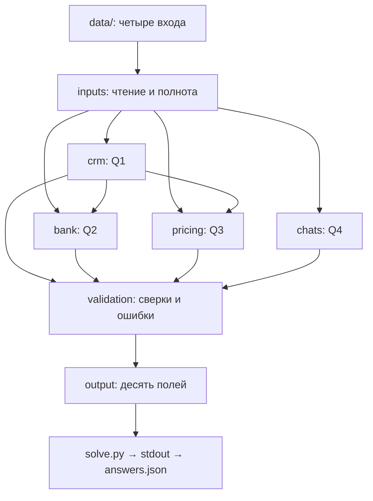

# Архитектура AK Furs

**Статус:** реализован частный Q1 в `src/akfurs/crm.py` со входом через `python -m akfurs.crm` и предметными тестами `tests/test_crm.py`. Полный Python CLI Q1–Q4 остаётся планируемым. Для Q4 выполняется отдельный приватный пилот адаптера к установленному `codex exec`; он не интегрирован в полный пересчёт. Проектный стек Data Skills установлен в рамках AKFURS-B-01, его финансовый протокол не является реализацией Q2.

## Существующая структура

```text
shelenkov-test-akfurs/
├── README.md
├── AGENTS.md
├── .gitignore
├── src/akfurs/
│   ├── AGENTS.md
│   ├── __init__.py
│   └── crm.py
├── contracts/AGENTS.md
├── tests/
│   ├── AGENTS.md
│   ├── test_crm.py
│   └── fixtures/synthetic/AGENTS.md
├── docs/
│   ├── AGENTS.md
│   ├── ARCHITECTURE.md
│   ├── EMPLOYER_REVIEW_GUIDE.md
│   └── review.md
├── inbox/                         # локальный исходный комплект, вне Git
└── data/                          # пустой локальный каталог входов, вне Git
```

`inbox/` содержит четыре операционных файла, исходный шаблон и ТЗ, экспортированное в DOCX. Материалы не перемещаются и не редактируются. `data/` предназначен для отдельной копии четырёх входов при будущем разрешённом запуске. Пустой `data/` не сохраняется Git; перед запуском его нужно создать и заполнить по README.

## Планируемые файлы

Дополнительно к исходному дереву существуют `.agents/skills/akfurs-*`,
`tools/data_processing/` (один вспомогательный CLI с модулями CSV/XLSX,
quality/reconciliation/validation), `tests/data_skills/`, `docs/data_skills/`
и исключённая из Git `.venv`. Это локальный слой инструментов; он не создаёт
параллельного решения Q1–Q5, сервисов или хранилища. Его контракт canonical
records и schema reconciliation protocol не являются контрактом `answers.json`.
Подробности и воспроизведение — [USAGE](data_skills/USAGE.md).

Существующий `crm.py` читает только CRM: строгий CSV → нормализованные ключи → счётчики Q1 и отбор максимального `Выгружено` → раздельные статусы Q1/канонической CRM и приватные основания. Ошибка ключа/структуры удерживает Q1; конфликт payload на максимуме удерживает CRM для Q2/Q3. Прайс, скидки и банк не фильтруют счётчики. Модуль не создаёт полный `answers.json` и не подтверждает поля будущих Q2/Q3.

Эти пути описывают будущую реализацию и сейчас отсутствуют:

| Путь | Ответственность |
|---|---|
| `solve.py` | Тонкая точка входа, вызовы модулей, exit code |
| `src/akfurs/inputs.py` | Чтение четырёх файлов, форматы и полнота |
| `src/akfurs/bank.py` | Q2, поступления и связь с заказами |
| `src/akfurs/pricing.py` | Q3, скидки, замены, исторические минимумы |
| `src/akfurs/chats.py` | Q4, AI-анализ и проверяемые основания |
| `src/akfurs/validation.py` | Сверки, инварианты и блокирующие ошибки |
| `src/akfurs/output.py` | Сборка десяти полей JSON |
| `contracts/answers.schema.json` | Машинная проверка структуры ответа |
| `tests/test_{bank,pricing,chats,output,end_to_end}.py` | Остальные предметные и сквозные проверки |
| `requirements.txt` | Зависимости после выбора реализации |

Локальные результаты: `answers.json` в корне; Q5, основания, диагностика и AI-экспорты в `private/`; кэш в `.cache/`, если понадобится. Эти пути исключены из Git и создаются только по необходимости.

## Поток данных



Поток запланирован. Исходный ТЗ и шаблон задают правила и контракт; в четыре операционных входа они не входят. Q5 готовится отдельно после приёмки расчётов.

## Границы

Точная денежная арифметика и предметные правила закреплены в [инструкциях модулей](../src/akfurs/AGENTS.md), JSON — в [контракте](../contracts/AGENTS.md), проверки — в [tests](../tests/AGENTS.md). CLI выдаёт только полный JSON либо явную ошибку.

Способ AI-анализа Q4 требует раннего опыта на новом чате и решения R0. В G02 явно разрешён ограниченный пилот через существующий Codex/OpenAI и независимый Q1 до формального закрытия общего R0. Новые runtime, зависимости и глобальные настройки этим не разрешены. Обязательны описание модели/запроса, повторного запуска и обработки сбоев. Наличие проверяемых цитат не доказывает смысловую правильность.

Реализация допускается отдельным поручением с соблюдением [этапов и R0–R3](review.md). Не добавляются сервисы и зависимости ради оформления. Готовность полного CLI, схемы всего ответа и окончательного комплекта пока не подтверждена.
